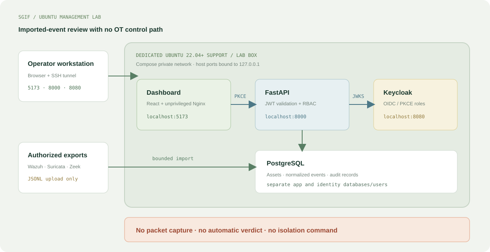

# SGIF Architecture Guide

## Scope

SGIF currently provides an Ubuntu management and imported-event review lab. It
is not an inline protection appliance, live packet sensor, incident verdict
engine, or OT control system.

## Services

- **React + unprivileged Nginx:** operator dashboard, served on host loopback
  port `5173`.
- **Keycloak:** OIDC login and reader/operator/admin realm roles, loopback
  port `8080`. Browser authentication uses Authorization Code + PKCE S256.
- **FastAPI:** API on loopback port `8000`. It validates RS256 signatures,
  issuer, `sgif-api` audience, expiry, subject, and realm roles.
- **PostgreSQL:** separate application and Keycloak databases, host loopback
  port `5432`; app and identity use different database users.
- **Ansible installer:** targets Ubuntu 22.04+ x86_64/ARM64 in the explicit
  `sgif_lab_servers` group. It installs Docker/Compose and writes Vault values
  to `/opt/sgif/.env` with mode `0600`.

All published ports bind to `127.0.0.1`. Remote browser access uses an SSH
tunnel. Do not expose the HTTP ports to a premise or OT network. The lab uses
Keycloak development HTTP mode and is not production identity configuration.

## Roles and API

| Route | Role | Purpose |
| --- | --- | --- |
| `GET /healthz` | Public | Check database connectivity |
| `GET /api/v1/assets` | Reader/operator/admin | Read asset inventory |
| `POST /api/v1/assets` | Operator/admin | Create asset and audit record |
| `GET /api/v1/events` | Reader/operator/admin | Read imported events |
| `POST /api/v1/events/import` | Operator/admin | Import bounded JSONL |

The import endpoint accepts up to 1 MB / 1,000 events. The Wazuh, Suricata
EVE, and Zeek adapters validate supported fields, normalize timestamps and
network tuples, deduplicate by SHA-256 content hash, and store an audit row.
Source severity is displayed as supplied; SGIF does not declare an incident.

## Data flow

1. An authorized operator exports data from an approved Wazuh, Suricata, or
   Zeek environment.
2. The operator signs in through Keycloak and uploads the JSONL file.
3. FastAPI validates the token and operator/admin role.
4. The normalizer rejects malformed records and maps supported fields.
5. PostgreSQL stores new events and records the import actor.
6. Authorized readers view the stored event fields in the dashboard.

There is no live sensor connection, packet capture, blocking action, or
command path back to a site. Real event files and inventories may expose
operational topology and must not be committed to this public repository.

## Persistence and recovery

PostgreSQL stores `assets`, `events`, and `audit_records`; Keycloak has its
own database. SQLAlchemy creates tables for a fresh lab. Versioned migrations,
production backup/restore, retention controls, and resource benchmarks are
not implemented yet. `docker compose down` preserves the volume;
`docker compose down -v` deletes it and is for disposable resets only.

## Safety roadmap

First validate the lab and authentication on the dedicated Ubuntu host. Later
sensor integration should be authorized, passive, and lab-tested with mirrored
traffic. Any response proposal needs explicit human approval, recovery access,
rollback testing, and operational safety review. Automatic isolation, PLC or
BESS commands, inline IPS, and network shutdown are out of scope.
